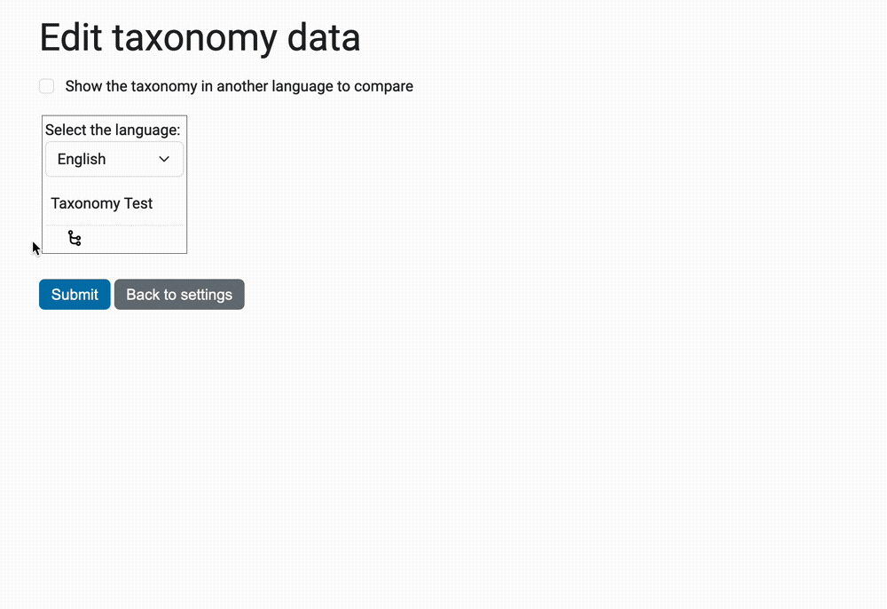

<div align="center">
    <h1 align="center">collective.taxonomy</h1>
</div>
<div align="center">

[](https://pypi.org/project/collective.taxonomy/)
[](https://pypi.org/project/collective.taxonomy/)
[](https://pypi.org/project/collective.taxonomy/)
[](https://pypi.org/project/collective.taxonomy/)
[](https://pypi.org/project/collective.taxonomy/)

[](https://pypi.org/project/collective.taxonomy/)

[](https://github.com/collective/collective.taxonomy/actions/workflows/main.yml)


[](https://github.com/collective/collective.taxonomy)
[](https://github.com/collective/collective.taxonomy)

</div>

Create, edit and use hierarchical taxonomies in [Plone](https://plone.org/).

This add-on provides support for hierarchical taxonomies in multiple languages, letting users easily associate existing content with terms from one or more taxonomies.

> [Taxonomy](https://en.wikipedia.org/wiki/Taxonomy) is the "discipline of defining groups \[...\] on the basis of shared characteristics and giving names to those groups. Each group is given a rank and groups of a given rank can be aggregated to form a super group of higher rank and thus create a hierarchical classification".

Here's an example of the "taxonomic kingdoms of life":

```
Living Organisms
Living Organisms -> Eukaryotic
Living Organisms -> Eukaryotic -> Simple multicells or unicells
Living Organisms -> Eukaryotic -> Multicellular
Living Organisms -> Eukaryotic -> Multicellular -> Autotrophic
Living Organisms -> Eukaryotic -> Multicellular -> ...
Living Organisms -> Prokaryotic
Living Organisms -> Prokaryotic -> Archaebacteria
Living Organisms -> Prokaryotic -> Eubacteria
Living Organisms -> Prokaryotic -> Eubacteria -> ...
```

Taxonomies can be quite large, sometimes in the tens of thousands (10,000+). And in sites with multiple languages, each title – or *caption* – must appear in translation.

Note that the selection of a term in the hierarchy implies the selection of all its parents. In the example above this means that if "Eubacteria" is selected, then also "Prokaryotic" and "Living Organisms" will be.

## Overview

The implementation tries to meet the following requirements:

1. Support many (10,000+) terms.
2. Terms can be organized in a hierarchical classification.
3. Easily import and export in a common format (VDEX).
4. Taxonomies will provide vocabularies that are translatable.
5. Use behaviors to provide a choice field for each taxonomy.
6. Manage taxonomies and assign to content types "through-the-web".

In the description below, we touch on each of these requirements.

### Data structure

In order to limit both the memory and computation requirements, the term data is contained in exactly one persistent index per language, a mapping from the *materialized term path* to its *term identifier*.

The term:

```
Living Organisms -> Eukaryotic -> Simple multicells or unicells
```

will be indexed under this path:

```
"Living Organisms/Eukaryotic/Simple multicells or unicells"
```

The index allows us to provide an iterator over the sorted vocabulary terms, virtually without cost (as well as containment queries).

At the same time, while the hierarchy is encoded, we can quickly look up terms in a subtree.

Note: As `collective.taxonomy` uses slash as separator, you have to monkey patch the `PATH_SEPARATOR` constant if you want to use '/' in your terms.

### Data exchange

While `collective.taxonomy` (this package) does make it possible to create, manage and edit taxonomies from a browser-based interface, the primary focus is to support the exchange of terms in the VDEX format:

> The [IMS Vocabulary Definition Exchange](http://www.imsglobal.org/vdex/) (VDEX) specification defines a grammar for the exchange of value lists of various classes: collections often denoted "vocabulary".

This exchange is integrated with [GenericSetup](https://pypi.org/project/Products.GenericSetup/) which manages imports and exports using setup profiles. It is also possible to use the control panel for importing and exporting VDEX files.

The package comes with integration for the [Dexterity](https://pypi.org/project/plone.app.dexterity/) content type framework: for each taxonomy, a *behavior* is available that adds a choice field which pulls its vocabulary from the taxonomy. The behavior is configurable in terms of field name, title and whether it allows the selection of one or more multiple terms. You should *first* install dexterity and then `collective.taxonomy`, otherwise the behaviors for the existing taxonomies will be missing.

### How does it work?

The main objective during this project has been to get a high rate of through-the-Web administration. Therefore the use of the product will not require any Python programming nor `configure.zcml` directives.

In the control panel (`/@@taxonomy-settings`), the user can:

1. Import taxonomies from VDEX files.
2. Export taxonomies existing to VDEX files.
3. Delete taxonomies
4. Add and delete behaviors for taxonomies

When a new behavior is created for a taxonomy, it can easily be added to the desired content types using the content type control panel, provided by Dexterity. After this is done, the taxonomy is available on add and edit forms, and it is also available for collections, if `plone.app.collection` is used on the site. An index is also created, so the taxonomies can easily be used for catalog queries.

Please read the detailed [Getting Started Tutorial](https://github.com/collective/collective.taxonomy/blob/master/docs/tutorial.md).

### React/Redux app to edit taxonomies

The view `@@taxonomy-edit-data` that allow users to edit the taxonomy data is a React/Redux app (the source code is in the `resources/` directory).

Here's a preview of this view:



The languages allowed for the taxonomies are the languages defined in `portal_languages`.

### REST API support

This package also supports endpoints for basic CRUD operations that can be consumed by any frontend service.

The API consumer can create, read, and delete taxonomies.

| Verb | URL | Action |
| --- | --- | --- |
| `POST` | `/@taxonomy` | Add taxonomy with specific data |
| `GET` | `/@taxonomy` | List all taxonomies |
| `GET` | `/@taxonomy/{name}` | Get taxonomy data |
| `DELETE` | `/@taxonomy/{name}` | Remove one or more taxonomies |
| `PATCH` | `/@taxonomy/{name}` | Update taxonomy data |
| `GET` | `/@taxonomySchema` | Get current taxonomy schema |

### Translations

This product has been translated into

- Danish.
- German.
- French.
- Spanish.

You can contribute for any message missing or other new languages, join us at [Plone Collective Team](https://www.transifex.com/plone/plone-collective/) into *Transifex.net* service with all world Plone translators community.

## Installation

Install collective.taxonomy with `pip`:

```shell
pip install collective.taxonomy
```

## Plone version compatibility

collective.taxonomy version `4.x`

- Plone 6.2 (Python 3.10 – 3.14)

collective.taxonomy version `3.x`

- Plone 6.1 (py3)
- Plone 6.0 (py3)

collective.taxonomy version `2.x`

- Plone 5.2 (py2/py3)
- Plone 5.1
- Plone 5.0

collective.taxonomy version `1.x`

- Plone 4.3
- or an older version using a recent version of [plone.dexterity](https://pypi.org/project/plone.dexterity/) / [plone.app.dexterity](https://pypi.org/project/plone.app.dexterity/)

## Frequently Asked Questions

How can I import an existing `ATVocabularyManager` vocabulary?

> Use the script provided in this [gist](https://gist.github.com/3826155). Just remember to edit the vocabIdentifier and vocabName.

## Contribute

Have an idea? Found a bug? Let us know by [opening a ticket](https://github.com/collective/collective.taxonomy/issues).

- [Issue tracker](https://github.com/collective/collective.taxonomy/issues)
- [Source code](https://github.com/collective/collective.taxonomy/)

### Prerequisites ✅

- An [operating system](https://6.docs.plone.org/install/create-project-cookieplone.html#prerequisites-for-installation) that runs all the requirements mentioned.
- [uv](https://6.docs.plone.org/install/create-project-cookieplone.html#uv)
- [Make](https://6.docs.plone.org/install/create-project-cookieplone.html#make)
- [Git](https://6.docs.plone.org/install/create-project-cookieplone.html#git)
- [Node.js](https://nodejs.org/) and [pnpm](https://pnpm.io/), for the JavaScript app and the acceptance tests

### Installation 🔧

1. Clone this repository, then change your working directory.

    ```shell
    git clone git@github.com:collective/collective.taxonomy.git
    cd collective.taxonomy
    ```

2. Install this code base.

    ```shell
    make install
    ```

3. Create a Plone site, and start the instance on `localhost:8080`.

    ```shell
    make create-site
    make start
    ```

### Tests and code quality

```shell
make test           # Python tests, with pytest
make test-coverage  # the same, with a coverage report
make lint           # ruff, pyroma, check-python-versions and zpretty
make format         # ruff and zpretty, fixing what they can
```

### JavaScript development

All JS development resources are in the directory `resources/` (the source code is in `resources/src/js`).

Dependencies are managed with [pnpm](https://pnpm.io/) and the bundle is built with webpack 5. The `make` targets below take care of running `pnpm install` for you, so you don't need to call `pnpm` directly.

While making changes to these files:

1. change to directory `resources/`
2. run `make serve`

This starts a webpack development server at `localhost:3000` and serves the JS files.

Now start your Plone instance with

```shell
NODE_ENV=development make start
```

and the taxonomy controlpanel will use the files served from the webpack server.

When you have finished your changes run:

```shell
make test
make build
```

this will build the resources and save it in `src/collective/taxonomy/static/js`.

#### i18n

The app uses [react-intl](https://github.com/yahoo/react-intl) to handle i18n. To translate the app, add a new language in the translations directory. For example, create a `es` file in the translations directory that contains:

```js
const es = {
    submitLabel: 'Enviar',
}

export default es
```

Then, edit `translations/index.js` to add the language to the translations object:

```js
import es from './es'

const translations = {
    es,
    fr
}
```

You'll have to rebuild the js bundle: `make build` (or `pnpm run build`)

That's it!

### Acceptance tests

The acceptance tests use [Playwright](https://playwright.dev/) and live in `resources/acceptance`.
They run against the Plone test fixture `collective.taxonomy.testing.ACCEPTANCE_TESTING`, started by `robot-server`, which also serves the Classic UI.

```shell
make acceptance-backend-start          # in its own terminal: the fixture on localhost:55001
make -C resources install-acceptance   # once: download the Chromium build Playwright uses
make acceptance-test                   # Playwright in UI mode
make ci-acceptance-test                # headless, as CI runs it
```

## Existing work

In 2010, Rok Garbas <rok@garbas.si> reimplemented and extended prior work by [Seantis](https://www.seantis.ch/) and released [collective.vdexvocabulary](https://pypi.org/project/collective.vdexvocabulary). This package allows you to configure and populate vocabulary components from a VDEX-specification. The package supports flat vocabularies only, and support for multiple languages takes a different approach (vocabularies are returned in an already translated form). Note that vocabularies are loaded in a read-only mode, although it's been proposed that vocabularies might be edited through-the-web.

In 2005, Jens Klein <jens.klein@bluedynamics.com> released [ATVocabularyManager](https://pypi.org/project/Products.ATVocabularyManager/). This package makes it possible to create taxonomies using Plone's content management interface with terms existing as regular site content. It's integrated with the [Archetypes](https://pypi.org/project/Products.Archetypes/) content type framework (now deprecated).

## Contributors

See [CONTRIBUTORS.md](https://github.com/collective/collective.taxonomy/blob/master/CONTRIBUTORS.md).

## License

The project is licensed under the GPL v2 or later (GPLv2+).
